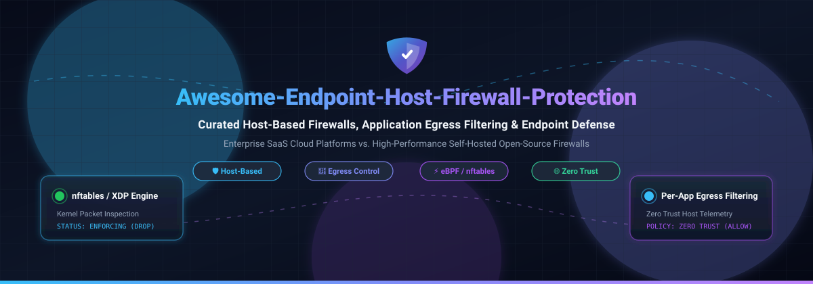

# Awesome-Endpoint-Host-Firewall-Protection

  

  
  
  
  
  
  
  

---

## 🛡️ Top Endpoint Host Firewall Protection (Open Source & Enterprise SaaS) 🌟 Star if you like it! 🌟

> **A comprehensive, SEO-optimized curated directory of enterprise SaaS solutions and open-source GitHub projects dedicated to Host-Based Firewalls, Application Egress Filtering, Per-Process Network Control, Zero-Trust Microsegmentation, and Self-Hosted Endpoint Defense.**

*Last updated: November 2026*

Endpoint Host Firewalls operate directly on endpoints (workstations, servers, laptops, and virtual containers) rather than on network edge perimeters. They enforce granular connection filtering, prevent lateral movement during cyber intrusions, block outbound data exfiltration, inspect application-level traffic, and provide audit-ready telemetry for SecOps and compliance teams.

---

## 📑 Table of Contents

- [📊 Sector Overview & Market Dynamics](#-sector-overview--market-dynamics)
- [☁️ SaaS / Enterprise Hosted Platforms](#️-saas--enterprise-hosted-platforms)
- [💻 Open-Source GitHub Projects](#-open-source-github-projects)
- [🧩 Architectural Comparison & Implementation Insights](#-architectural-comparison--implementation-insights)
- [🤝 How to Contribute](#-how-to-contribute)
- [⚠️ Disclaimer](#️-disclaimer)
- [📈 Star History](#-star-history)
- [☕ Support](#-support)

---

## 📊 Sector Overview & Market Dynamics

The global endpoint security and host-level protection market is estimated at **$16.3B to $17.8B in 2025–2026**, projected to exceed **$34B by 2034 at a compound annual growth rate (CAGR) of ~8.6% to 9.6%**. The sector is **moderately concentrated** among enterprise cybersecurity mega-vendors (Microsoft, CrowdStrike, Broadcom/Symantec, and Sophos) who dominate high-density corporate fleet management through unified EDR/XDR agent architectures, yet remains **vibrantly fragmented** at the host-level application and developer tier where specialized egress-filtering utilities and modular open-source engines (e.g., eBPF/XDP, nftables, LuLu, Portmaster) address critical gaps in transparency, privacy, and Linux/macOS ergonomics.

---

## ☁️ SaaS / Enterprise Hosted Platforms

Enterprise endpoint host firewalls provide centralized policy orchestration, global fleet synchronization, compliance reporting, and out-of-the-box telemetry aggregation.

### 🏢 SaaS Product Directory & Pricing Analysis

*All vendors sorted in descending order by enterprise market valuation / annual corporate revenue.*

| Product / Platform | Company Valuation / Revenue | Starting Pricing Tier | Free Tier & Free Trial Limits | Key Strengths & Deployment Focus |
| :--- | :--- | :--- | :--- | :--- |
| **[Microsoft Defender Firewall](https://www.microsoft.com/en-us/security/business/endpoint-security/microsoft-defender-endpoint)** | **~$3.1 Trillion** (Market Cap) | **Free** native with Windows 10/11; **$2.94/user/month** (Defender for Business annual) | **100% Free Forever** on Windows client OS (unlimited endpoints, local GUI & PowerShell). Enterprise centralized cloud portal: 30-day free trial up to 300 seats. | Native Windows Filtering Platform (WFP) deep integration; zero footprint overhead; cross-platform fleet management available via Intune and Defender for Endpoint. |
| **[Symantec Client Firewall](https://www.broadcom.com/products/cybersecurity/endpoint)** (Broadcom) | **~$800+ Billion** (Broadcom Market Cap) | **$39.00/user/year** (SES Enterprise baseline through distributors) | **30-day free trial** upon enterprise sales validation (covers up to 250 evaluation endpoints); no free-forever plan. | Deeply established enterprise host intrusion prevention (HIPS) and network tamper protection for existing Broadcom customers. |
| **[CrowdStrike Falcon Firewall Management](https://www.crowdstrike.com/products/endpoint-security/falcon-firewall-management/)** | **~$70+ Billion** (Market Cap) | **$14.99/device/month** or **$99.99/device/year** (Falcon Pro tier) | **Free Forever Tier**: Falcon Go tier offers **free management for up to 100 devices**; 15-day full-featured enterprise trial also available. | Unified single lightweight agent; instant cloud policy propagation; bi-directional host isolation and correlation with Falcon EDR telemetry. |
| **[Check Point Harmony Endpoint](https://www.checkpoint.com/harmony/endpoint/)** | **~$22 Billion** (Market Cap) | **$22.00/device/year** (~$1,100/year for 50-device block on Basic tier) | **30-day free trial** for up to 50 endpoints (full cloud management console access); no permanent free tier. | Enterprise-grade perimeter and host defense synchronization; robust anti-ransomware and zero-phishing integrations. |
| **[Sophos Endpoint Firewall](https://www.sophos.com/en-us/products/endpoint-antivirus)** (Intercept X) | **~$4 Billion** (Thoma Bravo Valuation) | **$28.00/user/year** (Sophos Intercept X Advanced baseline via partners) | **30-day free trial** with full cloud-managed Sophos Central console features (up to 100 test devices); no permanent free tier. | Synchronized Security heartbeat connecting host firewalls directly to Sophos XGS network firewall appliances for instant lateral isolation. |
| **[Kaspersky Endpoint Security](https://www.kaspersky.com/small-to-medium-business-security)** (Next Line) | **~$750 Million** (Annual Revenue) | **$28.00/device/year** (Kaspersky Next EDR Foundations, 5-device pack baseline) | **30-day free trial** for up to 50 endpoints with full Kaspersky Security Center Cloud access; no permanent free tier. | Mature host IPS engine, granular packet inspection rules, and lightweight client footprint across multi-OS fleets. |
| **[Trellix Endpoint Firewall](https://www.trellix.com/products/endpoint-security/)** (formerly McAfee/FireEye) | **~$700 Million** (Annual Revenue) | **$45.00/endpoint/year** (Trellix Endpoint Security Essentials baseline quote) | **30-day free trial** on-demand via Trellix enterprise proof-of-concept program; no permanent free tier. | Deeply configurable policy matrices for mission-critical enterprise workstation fleets and air-gapped infrastructure. |
| **[Bitdefender GravityZone Firewall](https://www.bitdefender.com/business/enterprise-products/endpoint-security.html)** | **~$400 Million** (Annual Revenue) | **$35.00/device/year** ($273/year for baseline 10-device pack) | **30-day free trial** for up to 100 endpoints with full cloud management features; no permanent free tier. | Clean, rapid-deployment cloud console; minimal client performance degradation; highly accurate automated application behavior rules. |
| **[ZoneAlarm Pro / Business](https://www.zonealarm.com/)** (Check Point Consumer/SMB) | Check Point Subsidiary (~$22B Parent) | **$39.95/year** (ZoneAlarm Pro Antivirus + Firewall, 5 PCs) | **Free Forever Tier**: ZoneAlarm Free Firewall (100% free for individual personal use on 1 PC, manual rule controls); 30-day trial for Pro. | Pioneer consumer/SMB two-way host firewall; stealth mode hides ports completely from external port scans. |
| **[Comodo Firewall / Xcitium Client](https://www.xcitium.com/client-security/)** | **~$100 Million** (Private / Xcitium) | **$39.00/endpoint/year** ($3.25/endpoint/month, 5-seat minimum) | **Free Forever Tier**: Comodo Free Firewall (100% free for personal use on 1 PC with auto-containment); 30-day trial for Xcitium Cloud. | Patented virtualized auto-containment; blocks untrusted process socket binding and malicious egress attempts before verification. |

---

## 💻 Open-Source GitHub Projects

Open-source host firewalls enable fully transparent, auditable, and self-hosted network defense. The list below features top community and kernel-level solutions sorted by GitHub Star counts.

### 🌟 Open-Source Repository Ranking

*All repositories sorted in descending order by GitHub Stars. Badges display real-time stargazers with `style=social`.*

| Project & Repository | Stars | Primary Platform | Architecture & Inspection Layer | Core Capabilities |
| :--- | :--- | :--- | :--- | :--- |
| **[Fail2ban](https://github.com/fail2ban/fail2ban)** |  | Linux | Log Analysis & Dynamic iptables/nftables | Scans auth logs (SSH, HTTP, mail) for brute-force attacks and dynamically bans malicious IPs via netfilter rules. |
| **[CrowdSec](https://github.com/crowdsecurity/crowdsec)** |  | Linux, Windows, macOS, BSD | Behavioral Telemetry & Firewall Bouncers | Collaborative intrusion prevention engine; parses system and application logs to trigger automatic remediation bouncers. |
| **[OpenSnitch](https://github.com/evilsocket/opensnitch)** |  | Linux | NFQUEUE, iptables/nftables & GUI/Daemon | Interactive application firewall porting Little Snitch ergonomics to Linux; alerts in real-time when apps open network connections. |
| **[Portmaster](https://github.com/safing/portmaster)** |  | Windows, Linux | Kernel Drivers (WFP) & eBPF / NFQUEUE | Privacy-first desktop application firewall; per-process network policies, automatic tracker/ad blocking, and Encrypted DNS (DoH/DoT). |
| **[LuLu](https://github.com/objective-see/LuLu)** |  | macOS | macOS Network Extensions API | Open-source macOS outgoing connection firewall; intercepts unauthorized egress traffic and prompts users per application. |
| **[Simplewall](https://github.com/henrypp/simplewall)** |  | Windows | Native Windows Filtering Platform (WFP) | Lightweight standalone UI to configure native Windows Filtering Platform without background telemetry; internal blocklists included. |
| **[pfSense](https://github.com/pfsense/pfsense)** |  | FreeBSD | Packet Filter (PF) & Web UI | Turnkey enterprise firewall and router software with stateful packet inspection, VPN gateways, and traffic shaping (*Perimeter defense*). |
| **[OPNsense](https://github.com/opnsense/core)** |  | HardenedBSD / FreeBSD | Packet Filter (PF) & MVC GUI | Open-source firewall and routing platform with inline IPS (Suricata), two-factor authentication, and web filtering (*Perimeter defense*). |
| **[firewalld](https://github.com/firewalld/firewalld)** |  | Linux | D-Bus daemon for nftables & iptables | Dynamically managed host firewall supporting network zones, trust interfaces, IP sets, and rich declarative rules. |
| **[SysWarden](https://github.com/duggytuxy/syswarden)** |  | Linux | Authoritative nftables & TUI Dashboard | Fail-closed host security orchestrator; auditable nftables enforcement, signed update manifests, and persistent CIDR blocklists. |
| **[OpenShield (OpenSnitch Fork)](https://github.com/gustavo-iniguez-goya/opensnitch)** |  | Linux | nftables & NFQUEUE Strict Mode | Enhanced branch featuring learning mode, strict UID process resolution, and fail-closed quarantine safeguards. |
| **[netxfw-shell / netxfw](https://github.com/livp123/netxfw-shell)** |  | Linux (Kernel 5.4+) | eBPF / XDP Driver Layer | Ultra-high performance packet dropping directly in network driver layer; bypasses kernel stack overhead for anti-DDoS protection. |

---

## 🧩 Architectural Comparison & Implementation Insights

Understanding the operational boundary of each defense layer ensures optimal architecture:

1. **Host-Based Firewalls vs. Network Perimeter Firewalls**:
   - *Perimeter Firewalls* ([pfSense](https://github.com/pfsense/pfsense), [OPNsense](https://github.com/opnsense/core)) filter traffic arriving at the edge router/gateway. Once an attacker breaches the subnet, perimeter appliances cannot inspect traffic moving laterally between endpoints.
   - *Host-Based Firewalls* ([Microsoft Defender Firewall](https://www.microsoft.com/en-us/security/business/endpoint-security/microsoft-defender-endpoint), [SysWarden](https://github.com/duggytuxy/syswarden), [firewalld](https://github.com/firewalld/firewalld)) inspect sockets directly on individual operating systems, providing defense against infected neighboring devices on the same Wi-Fi or LAN.

2. **Application Egress & Per-Process Filtering**:
   - Tools like [Portmaster](https://github.com/safing/portmaster), [OpenSnitch](https://github.com/evilsocket/opensnitch), and [LuLu](https://github.com/objective-see/LuLu) bind network packets to process PIDs, file hashes, and parent execution chains. This thwarts reverse shells, telemetry snooping, and covert data exfiltration.

3. **Kernel-Level eBPF / XDP Acceleration**:
   - Modern Linux host defense increasingly pairs userspace policy daemons with eBPF/XDP hooks ([netxfw](https://github.com/livp123/netxfw-shell)), dropping millions of malicious packets per second before memory allocations hit the kernel network stack.

---

## 🤝 How to Contribute

Contributions, project additions, and corrections are warmly welcomed! 

1. **Fork the repository** to your GitHub account.
2. **Create a descriptive feature branch**: `git checkout -b feature/add-new-host-firewall`.
3. **Add your entry** adhering to the existing markdown table formatting:
   - Ensure SaaS entries include verified starting prices and explicit free tier/trial durations.
   - Ensure open-source projects include official GitHub stargazers badge links.
4. **Commit your modifications**: `git commit -m "feat: add NewFirewall to open-source directory"`.
5. **Push and submit a Pull Request** with a brief summary of the software.

---

## ⚠️ Disclaimer

- This repository is a community-curated directory compiled for educational, architectural, and security evaluation purposes.
- Always test host firewall rules and fail-closed policies in staging or virtualized sandboxes before deploying across live enterprise infrastructure to avoid accidental loss of remote access (e.g., SSH/RDP lockouts).
- Product trademarks and service marks belong to their respective corporate entities.

---

## 📈 Star History

---

## ☕ Support

If you found this curated guide valuable for securing your hosts, endpoints, and server infrastructure, consider showing your support:

- ⭐ **Star this repository** to help others discover it across GitHub.
- 🍴 **Fork the project** and contribute additional firewall tools and guides.
- 📢 **Share this repository** with your fellow DevOps, SecOps, and SysAdmin colleagues.
- 💖 **Sponsor the Maintainer**: Support ongoing open-source curation and development via the [GitHub Sponsor Dashboard](https://github.com/sponsors/ishandutta2007).
